# AWS production architecture — Next.js on Amazon EKS

The Part 2 Next.js service (`next-bff-service`) runs on Amazon EKS in private subnets. It pulls its image from a private Amazon ECR repository, and its logs go to a private, KMS-encrypted Amazon S3 bucket. All the AWS infrastructure is Terraform in [`infra/`](infra/).

Delivery is GitOps:
- **GitHub Actions** builds the image and commits the new tag to [`k8s/`](k8s).
- **Argo CD** is the only thing that changes the cluster. Terraform installs it once (an operator-run bootstrap). From then on Argo CD deploys the service, the platform add-ons and itself from Git.
- **Infrastructure changes** are planned on pull requests and applied only after a merge and a reviewer's approval. That pipeline only calls AWS APIs; no CI job has Kubernetes credentials.

The diagram source, the request, deploy and log flows, and the trust boundaries are in [architecture/README.md](architecture/README.md). The Mermaid source is [architecture/architecture.mmd](architecture/architecture.mmd).

The service is stateless, so there is no database.

## Requirements checklist

| Requirement | Where |
|---|---|
| **1** Managed Kubernetes, private registry, logs to object storage | EKS [`modules/eks`](infra/modules/eks), ECR [`modules/ecr`](infra/modules/ecr), S3 [`modules/log-archive`](infra/modules/log-archive) + [Fluent Bit](k8s/platform/fluent-bit.yaml) |
| **1** Secure and reliable, explained and drawn | [What was created and why](#what-was-created-and-why), [architecture/](architecture/README.md) |
| **2.1** `/` shows "Hello World"; BFF health route | [`page.tsx`](application/src/app/page.tsx), [`api/health/route.ts`](application/src/app/api/health/route.ts) |
| **2.2** Multi-stage, non-root, health check, version/SHA tags | [`Dockerfile`](application/Dockerfile), [`app-ci.yml`](.github/workflows/app-ci.yml) |
| **2.3** Runs locally with one compose file | [`docker-compose.yml`](docker-compose.yml) |
| **2.4** Manifests in `k8s/`, probes on the BFF, exposed to the internet | [`deployment.yaml`](k8s/deployment.yaml), [`ingress.yaml`](k8s/ingress.yaml) |
| **3.1** CI on every push to `main`: lint, build, image `:<sha>`, update Git | [`app-ci.yml`](.github/workflows/app-ci.yml) |
| **3.2** GitOps installed as code, watches `k8s/`, prune and self-heal | [`infra/gitops-bootstrap`](infra/gitops-bootstrap/main.tf), [`k8s/platform/`](k8s/platform) |
| **3.2** Health from the BFF endpoint; rollback by `git revert` | Readiness probes + [`smoke-test-job.yaml`](k8s/smoke-test-job.yaml); [Rollback](#gitops-argo-cd) |
| **3.3** PRs: format, validate, preview; apply after merge and approval | [`infra.yml`](.github/workflows/infra.yml) |
| **3.4** CI has no cluster credentials; no secrets in the repo | [CI/CD and GitOps](#cicd-and-gitops), [Secrets](#secrets-and-ci-configuration) |

## Stacks and apply order

| # | Stack | State | What it creates |
|---|---|---|---|
| 1 | [`infra/bootstrap`](infra/bootstrap) | local | S3 bucket + KMS key for Terraform state (versioned, TLS-only, public access blocked, S3 native locking) |
| 2 | [`infra/environments/prod`](infra/environments/prod) | `prod/core.tfstate` | VPC, EKS, ECR, IAM, Route 53/ACM/WAF, log bucket, alarms |
| 3 | [`infra/gitops-bootstrap`](infra/gitops-bootstrap) | `prod/gitops-bootstrap.tfstate` | **Once, by an operator.** Installs Argo CD, its repository and cluster Secrets, the AppProjects and the root application |
| 4 | [`k8s/platform/`](k8s/platform) | Git | Argo CD ApplicationSets: AWS Load Balancer Controller, external-dns, metrics-server, Fluent Bit, Argo CD itself, and the service |
| 5 | [`k8s/`](k8s) | Git | The service's manifests, deployed and kept in sync by Argo CD |

- **Stacks 1 and 3 are applied by hand.** Stack 1 creates the state bucket. Stack 3 needs the private EKS API, so it runs from inside the VPC (VPN or SSM port-forward). It's re-run only to rebuild a cluster.
- **Stack 2:** after the first apply by an operator, which creates the CI roles, the [infra pipeline](#infrastructure-pipeline-githubworkflowsinfrayml) owns it.
- **Stacks 4 and 5** are Git: Argo CD applies every change.

Step-by-step commands are in [infra/README.md](infra/README.md).

## What was created and why

### Network: [`modules/network`](infra/modules/network)

- **VPC across 3 AZs** (`10.20.0.0/16`): `/24` public subnets hold only the ALB and NAT gateways. `/19` private subnets hold nodes and pods, sized for VPC CNI pod IPs with prefix delegation.
- **One NAT gateway per AZ**, each private subnet routed to the NAT in its own AZ, so losing one AZ doesn't cut egress for the other two.
- **VPC endpoints**: a gateway endpoint for S3, plus interface endpoints for ECR API/DKR, STS, CloudWatch Logs, EKS Auth (Pod Identity) and Secrets Manager. Image pulls, log uploads and credential exchange stay on the AWS network and don't depend on NAT.
- **VPC flow logs** go to CloudWatch with 90-day retention. The **default security group has all its rules removed** so nothing can use it by accident.
- Subnets are tagged `kubernetes.io/role/elb` / `internal-elb` so the Load Balancer Controller places the ALB correctly.

### Kubernetes: [`modules/eks`](infra/modules/eks)

- **EKS 1.36, private API endpoint** (the public endpoint is off by default; if you turn it on, the module rejects `0.0.0.0/0`). Kubernetes Secrets are encrypted with a dedicated **KMS key**. All five **control-plane log types** go to a log group with set retention. **Zonal shift** is enabled.
- **Access entries** (`authentication_mode = API`) instead of the `aws-auth` ConfigMap. The cluster creator gets no implicit admin; only the role ARNs you list in `eks_admin_role_arns` do.
- **Managed node group** (AL2023, on-demand, `m7i/m6i.large`, 3–6 nodes) in the private subnets. Root volumes are encrypted gp3. **IMDSv2 is required with hop limit 1**, so pods can't borrow the node's IAM role. Node access is through SSM Session Manager; there are no SSH keys.
- **EKS-managed add-ons**: VPC CNI (with **network policy enforcement** and prefix delegation), kube-proxy, CoreDNS, the Pod Identity agent, and CloudWatch Observability (Container Insights metrics only).

### Registry: [`modules/ecr`](infra/modules/ecr) and CI identity: [`modules/ci-identity`](infra/modules/ci-identity)

- **ECR with immutable tags**, so a version or commit SHA always resolves to the same digest. It has **scan on push**, KMS encryption, and a lifecycle policy that drops untagged images after 7 days and keeps the last 50 tagged images for rollback.
- **GitHub Actions OIDC provider + `ci-image-publisher` role**: trust is limited to `repo:<owner/name>:ref:refs/heads/main` and `refs/tags/v*`. Permissions cover pushing to this one repository and nothing else. CI never holds long-lived AWS keys.
- The Terraform pipeline's roles are covered in [CI/CD and GitOps](#cicd-and-gitops).
- Nodes pull with `AmazonEC2ContainerRegistryPullOnly`; no registry credentials are stored in the cluster.

### IAM for workloads: [`modules/workload-identity`](infra/modules/workload-identity)

Each workload gets its own IAM role, bound to its service account with **EKS Pod Identity**. The trust policy only allows `pods.eks.amazonaws.com` from this account:

| Role | Service account | Can do |
|---|---|---|
| `app` | `next-bff/next-bff-service` | Read Secrets Manager secrets under `prod/next-bff-service/*`. **No S3 access** |
| `fluent-bit` | `logging/fluent-bit` | `s3:PutObject` under `eks/*` in the log bucket + use its KMS key |
| `aws-load-balancer-controller` | `kube-system/aws-load-balancer-controller` | Upstream policy pinned to controller v3.6.0 |
| `external-dns` | `kube-system/external-dns` | Change records in the service's hosted zone only |

The EKS cluster, nodes, VPC flow logs and the CloudWatch agent each have their own service roles inside their modules.

### Edge, DNS and TLS: [`modules/edge`](infra/modules/edge)

- **Route 53**: by default the stack looks up an existing public hosted zone (`create_hosted_zone = true` creates one and adds a CAA record restricting issuance to Amazon). **external-dns** (an Argo CD add-on) writes the alias record for the service hostname to the ALB, with `upsert-only` policy and TXT ownership records.
- **ACM certificate** for the hostname, validated through DNS automatically.
- **WAFv2 web ACL**: a per-IP rate limit plus the AWS IP Reputation, Common and Known Bad Inputs managed rule groups. WAF logs go to CloudWatch with the `Authorization` and `Cookie` headers redacted.
- The ALB itself comes from the Kubernetes Ingress. It has HTTP→HTTPS redirect, a TLS 1.3/1.2 policy, the WAF and certificate attached, deletion protection, and invalid headers dropped.

### Logs to object storage: [`modules/log-archive`](infra/modules/log-archive) + Fluent Bit

- The app writes JSON logs to stdout. **Fluent Bit** (a DaemonSet) tails the container logs, adds Kubernetes metadata, buffers on the node's disk, and writes gzip objects to `s3://<bucket>/eks/<cluster>/YYYY/MM/DD/HH/…`, retrying indefinitely.
- The bucket has **Block Public Access**, `BucketOwnerEnforced`, **SSE-KMS** with a dedicated key and bucket key, versioning, a TLS-only bucket policy, and lifecycle rules: Standard-IA at 30 days, Glacier IR at 90, expiry at 365 (configurable).
- Only the Fluent Bit role can write to it; the app can't touch the bucket.

### Monitoring: [`modules/observability`](infra/modules/observability)

A KMS-encrypted SNS alerts topic (with email subscriptions) and CloudWatch alarms for failed nodes, sustained node CPU above 80%, and fewer than 2 running service pods.

### Application runtime: [`k8s/`](k8s)

Environment values are kept out of the manifests:
- **The image** is the logical name `next-bff-service`. [`kustomization.yaml`](k8s/kustomization.yaml) maps it to the ECR repository and the commit-SHA tag that CI writes.
  - That committed line is the deploy record, so it does contain the real ECR URL, account ID included.
  - Until CI's first run it holds a placeholder account, so the first Argo CD sync shows `ImagePullBackOff` until the first image is pushed.
- **Everything else** (the Ingress hostname, certificate ARN, WAF ARN and the NetworkPolicy's VPC CIDR) is patched in by the service's Argo CD ApplicationSet from the cluster-Secret annotations (see [GitOps](#gitops-argo-cd)).
  - The CIDR patch starts with a JSON-patch `test` on the expected default, so if the manifest's layout changes, the sync fails loudly instead of patching the wrong rule.

Restricted Pod Security Standard on the namespace. Non-root UID 1001, read-only root filesystem, all capabilities dropped, seccomp `RuntimeDefault`. Startup, readiness and liveness probes on `/api/health`. Resource requests and limits. Pods are spread across zones and hosts. **HPA** scales between 3 and 12 replicas. A **PDB** keeps at least 2 pods up. Rolling updates use `maxUnavailable: 0` and a `preStop` delay so the ALB drains a pod before it stops. A **NetworkPolicy** allows ingress only from the VPC on port 3000.

### Container image: [`application/Dockerfile`](application/Dockerfile)

A 3-stage build (deps → build → runner) using Next.js `standalone` output, so the runtime image contains only the traced production files. The `node:22-alpine` base is pinned by digest, and Dependabot updates it. It uses an npm cache mount, runs as **numeric** `USER 1001:1001` (required for `runAsNonRoot` to be verifiable), has a `HEALTHCHECK` on `/api/health`, and OCI labels for version and commit. Images are tagged `<version>` or `<git sha>` and pushed to ECR. Because the tags are immutable, overwriting `latest`-style tags isn't possible.

## CI/CD and GitOps

CI only builds and changes Git. Argo CD deploys whatever is in Git to the cluster.

**No pipeline can reach the cluster:**
- No workflow runs `kubectl`, Helm or a Kubernetes provider.
- No CI role has an EKS access entry, so even the Terraform apply role can't authenticate to the Kubernetes API.
- The CI roles call AWS APIs only: ECR push, and Terraform on the core stack.

### Application CI: [`.github/workflows/app-ci.yml`](.github/workflows/app-ci.yml)

Runs on every push to `main`. Pull requests run only the first job.

1. **lint-build**: `npm ci`, `npm run lint` (ESLint with `eslint-config-next`), `npm run build`. Runs on every push.
2. **changes**: diffs the push. The image and deploy jobs run only when `application/` (or this workflow) changed.
   - A docs-only or `k8s/`-only push never rolls out a fresh image.
   - Neither does reverting a deploy commit, which matters for rollback.
3. **image**: assumes `ci-image-publisher` through OIDC, then builds with Buildx and the GHA layer cache, passing the commit SHA as `VERSION`/`GIT_SHA`.
   - Trivy scans the local image. CRITICAL, fixable findings fail the job before anything is pushed.
   - The image is pushed as `<ecr>/next-bff-service:<commit sha>`.
   - A re-run skips the build if that tag already exists, because tags are immutable.
4. **update-manifests**: runs `kustomize edit set image next-bff-service=<ecr>:<sha>` in `k8s/` and pushes a `deploy(next-bff-service): <sha>` commit to `main` using the workflow's `GITHUB_TOKEN`.
   - That commit is the deploy trigger.
   - It can't loop: GitHub doesn't start workflows for `GITHUB_TOKEN` commits, and the change is outside `application/`.
   - `concurrency` keeps releases in order.

All third-party actions are pinned to commit SHAs, and Dependabot keeps them current. Every job starts from `contents: read` and asks only for what it needs.

### GitOps: Argo CD

**Bootstrap, run once** ([`infra/gitops-bootstrap`](infra/gitops-bootstrap/main.tf)). An operator applies it from inside the VPC. It:
1. **Installs Argo CD** from the pinned `argo-cd` Helm chart, using [`k8s/platform/values/argo-cd.yaml`](k8s/platform/values/argo-cd.yaml). The install is HA: Redis HA, plus two replicas of the server, repo-server and ApplicationSet controller.
   - The server is ClusterIP only, with no public UI. Operators use `kubectl port-forward` until SSO is configured.
   - Terraform then ignores the release. Argo CD manages its own chart from the same values file, so upgrading Argo CD is a commit.
2. **Creates the repository Secret** with a read-only GitHub deploy key, because the repo is private.
   - The key is stored in Secrets Manager (`prod/argocd/repo-deploy-key`; the core stack creates the empty secret).
   - It never appears in Git or in Helm values.
3. **Creates the in-cluster Secret** with the core stack outputs as annotations: region, cluster name, VPC ID and CIDR, log bucket, hosted zone, hostname, certificate ARN, WAF ARN. This is the GitOps-bridge pattern.
   - The ApplicationSets read those values through the cluster generator.
   - The manifests hardcode no hostnames, ARNs or VPC ranges.
   - The one environment value in Git is deliberate: the image reference that CI commits to `kustomization.yaml` (`<account>.dkr.ecr.<region>.amazonaws.com/next-bff-service:<sha>`). That line *is* the deploy record.
4. **Creates three AppProjects** as security boundaries:
   - `bootstrap` may only create ApplicationSets in `argocd`.
   - `platform` holds the add-ons, in `argocd`, `kube-system` and `logging` only.
   - `next-bff` limits the source to this repository and the destination to the `next-bff` namespace. The Namespace is the only cluster-scoped resource it allows.
5. **Creates the root application** (app-of-apps), which syncs [`k8s/platform/`](k8s/platform).

**Everything else is Git** ([`k8s/platform/`](k8s/platform)): one ApplicationSet each for:
- Argo CD itself
- the AWS Load Balancer Controller
- external-dns
- metrics-server
- Fluent Bit
- the service

Each has automated sync with prune and self-heal, and pinned chart versions. Failed syncs retry with backoff, for example while the load balancer controller's webhook starts.

**The service** ([`next-bff-service.yaml`](k8s/platform/next-bff-service.yaml)):
- **Watches `k8s/`:** it tracks `main`, path `k8s`, with `syncPolicy.automated { prune: true, selfHeal: true }`.
  - Every committed change is applied, deleted manifests are pruned, and manual edits in the cluster are reverted.
  - The only ignored drift is `Deployment.spec.replicas`, which the HPA owns (`RespectIgnoreDifferences=true`).
- **Health from the BFF endpoint:**
  - The Deployment is only Healthy once its pods pass readiness probes on `/api/health`.
  - The ALB target group checks the same path.
  - After each sync, a `PostSync` hook Job ([`k8s/smoke-test-job.yaml`](k8s/smoke-test-job.yaml)) calls `http://next-bff-service:3000/api/health` through the Service. Anything other than a 2xx fails the sync.
- **Rollback:** `git revert <deploy commit>` and push. Argo CD syncs the earlier tag within its 3-minute poll. Immutable tags guarantee it's the same image as before.
- **Deleting the Application:** it has no `resources-finalizer`, on purpose. Deleting the Application doesn't delete the running service.

### Infrastructure pipeline: [`.github/workflows/infra.yml`](.github/workflows/infra.yml)

| Event | Jobs |
|---|---|
| Pull request touching `infra/` | `terraform fmt -check`, `init -backend=false` + `validate` on every stack, `tflint` (recommended + AWS rulesets). Then `plan` of the core stack with the read-only plan role (`-lock=false`), posted as a sticky PR comment. |
| Push to `main` (after merge) | `apply` in the GitHub `production` environment, which waits for a required reviewer. It re-plans and applies the core stack. |

- **What it manages:** the core stack only, all through AWS APIs. Jobs run on GitHub-hosted runners. The gitops-bootstrap stack is validated here, but applied once by an operator: it's the only Terraform that talks to Kubernetes.
- **Roles** ([`modules/ci-terraform`](infra/modules/ci-terraform)):
  - **`ci-terraform-plan`** is trusted only for `repo:<repo>:pull_request`. It has `ReadOnlyAccess` plus read access on the state bucket and its KMS key.
    - An explicit deny blocks S3 object reads outside the state bucket, so application logs stay out of reach.
    - PRs from forks get no OIDC token, so they never reach it.
  - **`ci-terraform-apply`** is trusted only for `repo:<repo>:environment:production`, so GitHub won't issue the token until the environment's reviewers approve.
  - Neither role has an EKS access entry.
- **Bootstrapping:** the first core apply is run by an operator, because it creates these roles. From then on the pipeline owns the core stack.

### Secrets and CI configuration

There are no secrets in the repository; gitleaks scans every push and PR ([`security.yml`](.github/workflows/security.yml)). Everything environment-specific lives in the GitHub secret store:

| Name | Kind | Value |
|---|---|---|
| `AWS_REGION`, `ECR_REPOSITORY` | variable | e.g. `us-east-1`, `next-bff-service` |
| `AWS_IMAGE_PUBLISHER_ROLE_ARN` | variable | core output `ci_image_publisher_role_arn` |
| `AWS_TERRAFORM_PLAN_ROLE_ARN`, `AWS_TERRAFORM_APPLY_ROLE_ARN` | variable | core outputs `terraform_plan_role_arn`, `terraform_apply_role_arn` |
| `TF_STATE_BUCKET`, `TF_STATE_KMS_KEY_ARN` | variable | bootstrap outputs |
| `PROD_TFVARS` | secret | contents of `infra/environments/prod/terraform.tfvars` |

Role ARNs are not secrets, but keeping them in variables keeps account IDs out of the repo. The Argo CD deploy key and application secrets live in AWS Secrets Manager.

## Production assumptions and follow-ups

- **Region / account**: `us-east-1` is the default. Run production in a dedicated account and keep non-production in separate accounts with their own `environments/<env>` directory.
- **Reaching the private API**: only humans need it, for the one-time `infra/gitops-bootstrap` and for `kubectl` debugging. They run from inside the VPC (VPN or SSM port-forward). Alternatively, set `eks_endpoint_public_access` to an office/VPN CIDR.
- **Node autoscaling**: the node group has fixed min/max values. Add Karpenter or Cluster Autoscaler (with its own Pod Identity role) before relying on the HPA ceiling.
- **ALB alarms and access logs**: the ALB is created by the controller, so 5xx/latency alarms and ALB access logs (these need an SSE-S3 bucket) are added once its name is known.
- **Argo CD access**: add SSO (Dex or OIDC against the identity provider) and RBAC, then disable the local admin. Add a GitHub webhook to cut the 3-minute poll, and Argo CD Notifications (Slack or SNS) for sync failures.
- **Progressive delivery**: Argo Rollouts with an ALB canary and analysis on 5xx rate would let failed releases roll back automatically, rather than through a revert commit.
- **Supply chain**: sign images with cosign in CI, and enforce signatures in the cluster (e.g. Kyverno).
- **Apply role scope**: `ci-terraform-apply` has `AdministratorAccess`. Replace it with a scoped policy or a permissions boundary once the set of resource types settles. Add an SCP or boundary that denies `eks:CreateAccessEntry` and `eks:AssociateAccessPolicy` to CI roles, so they can't grant themselves cluster access.
- **Branch protection**: require PRs and status checks on `main`, and allow only the Actions bot to push deploy commits (a ruleset bypass).
