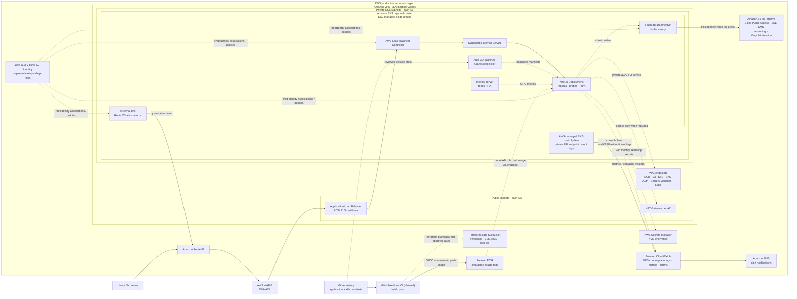

# AWS architecture design: Next.js on Amazon EKS

This is an AWS-specific reference diagram. Its standalone Mermaid source is [architecture.mmd](architecture.mmd); the overview and implementation sequence are in [../ARCHITECTURE.md](../ARCHITECTURE.md). The diagram shows one production AWS account/region, a VPC across three Availability Zones, and the AWS managed services around the EKS workload.

## Components and request flow

1. **DNS and edge:** Route 53 hosts the service record. AWS WAFv2 Web ACL is associated with the ALB to apply managed/custom rules and rate limits. ACM provides the public TLS certificate; the ALB terminates HTTPS and forwards only to healthy targets. The ALB is internet-facing in public subnets; the worker nodes remain private.
2. **Amazon VPC:** Use a dedicated VPC with non-overlapping CIDRs and subnets in three AZs. Place the ALB in public subnets and EKS nodes/pods in private subnets. Route private outbound traffic through a NAT Gateway in each AZ to avoid cross-AZ dependency. Security groups restrict ALB-to-node traffic and node egress. Add VPC endpoints for AWS services (ECR API/Docker, S3, STS, Secrets Manager, CloudWatch Logs) as appropriate to reduce public egress.
3. **EKS and compute:** EKS supplies the managed regional Kubernetes control plane with a private API endpoint. EC2 managed node groups are distributed over private subnets/AZs. Configure cluster/node IAM roles, encryption for Kubernetes secrets with KMS, control-plane audit/API/authenticator logs, and tested upgrade policies. EKS security groups and Kubernetes NetworkPolicies limit traffic.
4. **Ingress to Next.js:** AWS Load Balancer Controller runs in the cluster and has a dedicated EKS Pod Identity IAM role to provision/manage the ALB. An ALB-backed Kubernetes Ingress routes to an internal ClusterIP Service and then to a Deployment. Set at least two replicas, topology spread, startup/readiness/liveness probes, resource requests/limits, HPA, PodDisruptionBudget, and rolling-update limits.
5. **Build and release:** GitHub Actions authenticates to AWS using OIDC and a short-lived, scoped IAM role—no long-lived AWS access key. CI tests, scans, signs and pushes immutable image digests to ECR. EKS node IAM permissions allow pulling only required ECR images, preferably via VPC endpoints. Argo CD reads reviewed deployment configuration and reconciles it; CI has no standing Kubernetes administrator credentials.
6. **Logs to object storage:** The app writes structured logs to stdout/stderr. Fluent Bit runs as a DaemonSet, buffers and retries, then writes to an S3 bucket/prefix with its own Pod Identity role. Deny public access, require TLS and SSE-KMS, enable versioning, configure lifecycle/retention and alert on delivery errors. The application role does not get S3 write access.
7. **Secrets and identity:** EKS Pod Identity associates distinct IAM roles with the app, Fluent Bit, and AWS Load Balancer Controller. The app role can read only named Secrets Manager secrets. Use KMS, rotation where supported, and the Secrets Store CSI Driver only if the app requires mounted secret files. Never commit secret values or AWS credentials.
8. **Observability and operations:** Enable EKS control-plane logs to CloudWatch, Container Insights or equivalent workload metrics, CloudWatch alarms, and SNS notification topics. Monitor ALB 4xx/5xx and latency, pod health/restarts, CPU/memory, node capacity, deployment failures, and S3 delivery. Keep S3 as durable archive and CloudWatch as operational search/alerting.
9. **Infrastructure state:** Store Terraform state in a separate, encrypted and versioned S3 bucket, restricted to the infrastructure deployment role. Use S3 native lock files where supported by the Terraform version. Protect state because it can contain sensitive resource metadata; never store state in the application repo.

## Why these boundaries matter

- Only Route 53/ALB are public entry points. EKS API, nodes, and pods are private; no public node IPs are needed.
- Separate IAM roles for CI, EKS nodes, the app, Fluent Bit, and the AWS Load Balancer Controller enforce least privilege.
- Images are pulled from private ECR; secrets are read from Secrets Manager; logs are written to S3 by the collector, not by the app.
- Multi-AZ subnets, nodes, replicas, and NAT gateways reduce single-AZ dependencies. Regional service capacity and quotas still need to be planned.
- Keep production in a dedicated AWS account and separate it from development/test accounts. Restrict human access through IAM Identity Center and audit privileged actions.

## Practical notes

- This design uses an ALB directly protected by AWS WAFv2; CloudFront is optional, not required. Add CloudFront only for CDN caching/global edge needs, then associate WAF appropriately and update origin/network protections.
- The diagram matches the Terraform in `infra/` and the manifests in `k8s/`. Components marked "planned" (CI workflow, Argo CD) are not yet configured.
- No database is included because the service requirements do not mention one. Add a managed data service only if the application needs persistent state.
