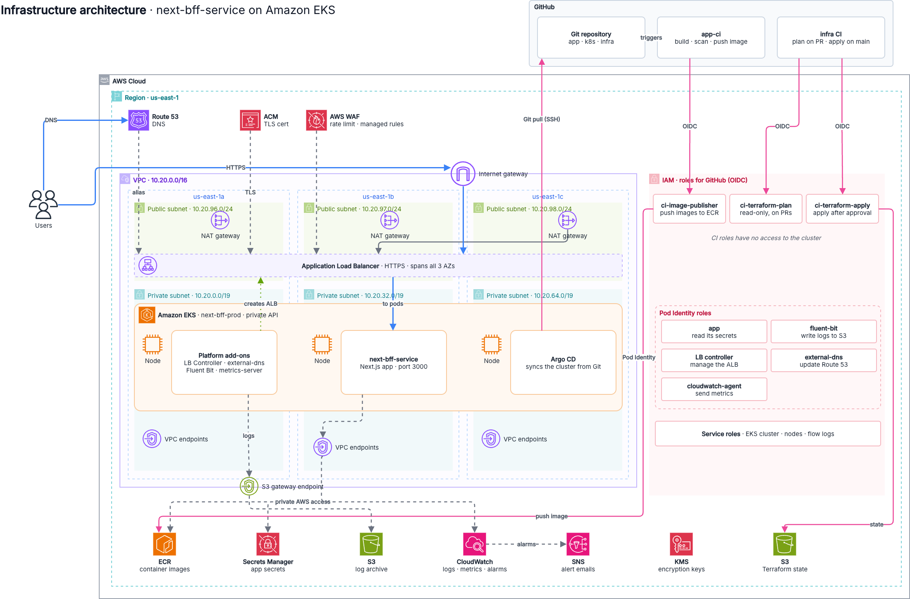

# Architecture design: Next.js on Amazon EKS with GitOps

- **Narrative and rationale:** [../ARCHITECTURE.md](../ARCHITECTURE.md).
- **Known gaps and trade-offs:** [room-for-improvement.md](room-for-improvement.md).
- **Backup and restore runbook:** [backup-and-restore.md](backup-and-restore.md).
- **Chaos test plan:** [chaos-test-plan.md](chaos-test-plan.md).
- **Repository layout and why it's split this way:** [repo-structure.pdf](repo-structure.pdf).

| Diagram | Answers | Source | Image |
|---|---|---|---|
| Infrastructure | Where it runs: region, VPC and subnets per AZ, EKS, edge, IAM roles | [infrastructure.drawio](infrastructure.drawio) | [png](infrastructure.png) |
| Kubernetes components | What runs in the cluster: namespaces, the service's resources, add-ons, Argo CD | [k8s-components.drawio](k8s-components.drawio) | [png](k8s-components.png) |
| Application pipeline | How a change ships: PR → CI → ECR → Argo CD → smoke test → rollback | [application-pipeline-activity.drawio](application-pipeline-activity.drawio) | [png](application-pipeline-activity.png) |

To change a diagram, edit the `.drawio` source in [draw.io](https://app.diagrams.net) (or the desktop app), then export it as PNG over the image with the same name. Commit both together.

## Scope

One AWS production account in one region, `us-east-1` (an assumption; see [Region and network](../ARCHITECTURE.md#region-and-network-modulesnetwork)). A VPC (`10.20.0.0/16`) across three Availability Zones, with one public `/24` and one private `/19` subnet in each, holds a private EKS cluster that runs `next-bff-service`. GitHub hosts the code and the pipelines. Every box in the diagram is defined in this repository:
- **AWS resources:** `infra/`
- **Workload manifests:** `k8s/`
- **Argo CD ApplicationSets:** `k8s/platform/`
- **Pipelines:** `.github/workflows/`

## Flows

### 1. Request path

1. **DNS:** the user resolves the service hostname in Route 53. external-dns maintains that alias record and points it at the ALB.
2. **Edge:** the internet-facing ALB in the public subnets terminates TLS with the ACM certificate. The WAF web ACL attached to it applies a per-IP rate limit and the AWS managed rule groups. HTTP redirects to HTTPS.
3. **To the pods:** the ALB sends traffic straight to pod IPs in the private subnets (`target-type: ip`). Its health check uses `/api/health`.
4. **Pod admission:** the NetworkPolicy only admits traffic from inside the VPC on port 3000.

### 2. Application delivery: CI changes Git, Argo CD changes the cluster

1. Every push to `main` starts **app-ci**, which lints and builds the app.
2. The image and deploy jobs run next, on every push.
3. They assume `ci-image-publisher` through GitHub OIDC, builds the image, scans it with Trivy (CRITICAL findings fail the job) and pushes `<ecr>/next-bff-service:<commit sha>`. ECR tags are immutable.
4. It then runs `kustomize edit set image` in `k8s/` and pushes a `deploy(next-bff-service): <sha>` commit to `main`.
5. **Argo CD** runs inside the cluster and polls `main` over SSH with a read-only deploy key. It applies `k8s/` with automated sync, prune and self-heal: manual changes in the cluster are reverted, and deleted manifests are removed.
6. **Health:** the Deployment only becomes ready when the `/api/health` readiness probes pass. After each sync a PostSync Job calls `/api/health` through the Service, and a failure marks the sync as failed.
7. **Rollback:** `git revert` the commit that broke the app. CI builds the reverted code and Argo CD deploys it. Emergency path: revert the deploy commit with `[skip ci]`, so Argo CD syncs the previous tag without a build.

CI never holds cluster credentials and never runs `kubectl`.

### 3. Infrastructure delivery

1. **On a pull request** that touches `infra/`, the infra workflow:
   - runs `terraform fmt`, `validate` and tflint on every stack
   - plans the core stack with the read-only `ci-terraform-plan` role
   - posts the plan as a PR comment
2. **After a merge to `main`**, the `apply` job waits in the `production` GitHub environment for a required reviewer. Only jobs in that environment can assume `ci-terraform-apply`. It re-plans and applies the core stack.
3. **What it touches:** only the core stack, through AWS APIs. No CI role has an EKS access entry, so the pipeline can't reach the Kubernetes API.

### 4. Cluster contents: bootstrap once, then Git

1. **Bootstrap:** an operator applies `infra/gitops-bootstrap` once, from inside the VPC. It installs Argo CD, the repository and cluster Secrets, the AppProjects and the root application.
2. **Root application:** syncs the ApplicationSets in `k8s/platform/`. They deploy the AWS Load Balancer Controller, external-dns, metrics-server, Fluent Bit, the service, and Argo CD itself.
3. **Environment values:** the ApplicationSets read them from annotations on the in-cluster Secret, so the manifests hardcode no hostnames, ARNs or VPC ranges. The only environment value in Git is the image reference CI commits, which is the deploy record.
4. **Changes:** from here on, any change to anything in the cluster is a commit.

### 5. Logs

The app writes JSON to stdout. The Fluent Bit DaemonSet then:
1. tails the container logs and adds Kubernetes metadata
2. buffers on the node's disk
3. writes gzip objects to the S3 log archive under `eks/<cluster>/YYYY/MM/DD/HH/`, using its own Pod Identity role

The bucket is private, KMS-encrypted and versioned, with lifecycle tiering. The app's own role cannot touch it.

## Trust boundaries

| Boundary | Who crosses it | How |
|---|---|---|
| GitHub → AWS (images) | app-ci on `main` | OIDC → `ci-image-publisher`, ECR push to one repository only |
| GitHub → AWS (infra plan) | infra workflow on same-repo PRs | OIDC `pull_request` → `ci-terraform-plan`, read-only, cannot read S3 objects outside the state bucket |
| GitHub → AWS (infra apply) | infra workflow after reviewer approval | OIDC `environment:production` → `ci-terraform-apply` |
| GitHub → Kubernetes API | nobody | Private endpoint; no CI role has an EKS access entry |
| Operator → Kubernetes API | `eks_admin_role_arns` (humans), for the one-time bootstrap and debugging | VPN or SSM into the VPC, EKS access entry |
| Git → cluster | Argo CD only (service, add-ons, itself) | Pulls with a read-only deploy key held in Secrets Manager |
| Pods → AWS | app, Fluent Bit, LB controller, external-dns | One EKS Pod Identity role each; IMDS blocked for pods (hop limit 1) |
| Internet → service | users | Route 53 → WAF → ALB (TLS) → pods; nodes have no public IPs |

## Availability

- **Zones:** three AZs, each with its own subnets and NAT gateway.
- **Service:** at least 3 replicas spread across zones and hosts, HPA up to 12, PDB `minAvailable: 2`, and rolling updates with `maxUnavailable: 0`.
- **Platform:** the controllers run 2 replicas each, all managed by Argo CD. Argo CD runs in HA mode: Redis HA, plus two replicas of the server, repo-server and ApplicationSet controller.
- **Recovery:** Terraform state is versioned and every deploy is a Git commit, so the cluster can be rebuilt from Git plus state. Procedures: [backup-and-restore.md](backup-and-restore.md).
