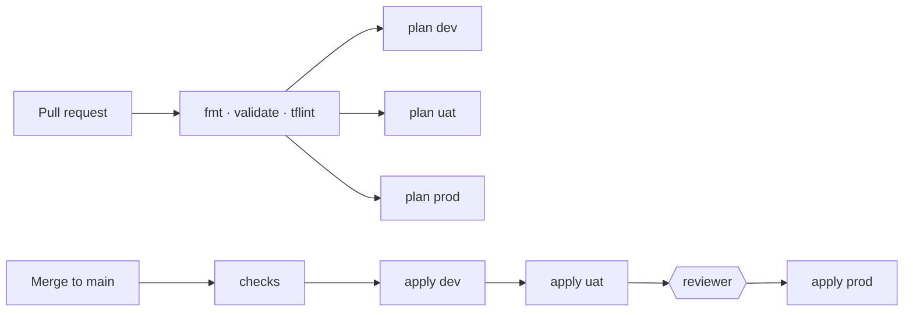

# Environments: dev, uat and prod from one stack

One Terraform root, [`infra/core`](../infra/core), builds every environment. Environments differ only in **configuration**, never in code. A change is reviewed once and then promoted through dev, uat and prod by the [infra pipeline](../.github/workflows/infra.yml).

## Layout

```
infra/
├── core/                  # the one root module: VPC, EKS, ECR, IAM, edge, logs, alarms
├── environments/
│   ├── dev/               # terraform.tfvars.example, backend.hcl.example
│   ├── uat/
│   └── prod/
└── modules/               # building blocks used by core
```

| | dev | uat | prod |
|---|---|---|---|
| **Purpose** | Try changes cheaply | Production rehearsal | Live traffic |
| **AWS account** | own | own | own |
| **AZs** | 2 | 3 | 3 |
| **Nodes (min / desired / max)** | 2 / 2 / 4 | 3 / 3 / 6 | 3 / 3 / 6 |
| **VPC CIDR** | `10.10.0.0/16` | `10.15.0.0/16` | `10.20.0.0/16` |
| **DNS** | `app.dev.example.com`, own zone delegated from prod | `app.uat.example.com`, delegated | `app.example.com` |
| **Log retention** | 30 days | 90 days | 365 days |
| **State** | `dev/core.tfstate` | `uat/core.tfstate` | `prod/core.tfstate` |
| **GitHub environment** (apply gate) | `dev` | `uat` | `production`, required reviewers |

The VPC ranges don't overlap, so the environments can be peered or joined to a Transit Gateway later without renumbering.

## Why one account per environment

- **Blast radius:** an IAM mistake or a runaway apply in dev can't touch prod. The account is the strongest boundary AWS has.
- **No name collisions:** the ECR repository, the GitHub OIDC provider and IAM role names can be the same in each account, so the code needs no per-environment special cases.
- **Clear cost:** each account's bill is one environment's bill.

Each account runs [`infra/bootstrap`](../infra/bootstrap) once for its own state bucket and KMS key.

## How an environment is chosen

| Input | dev example | Where it comes from |
|---|---|---|
| `environment` | `dev` | CI passes `-var environment=dev` from the matrix. A `-var` beats the tfvars file, so the name always matches the state key. The variable only accepts `dev`, `uat` or `prod`. |
| State key | `dev/core.tfstate` | `-backend-config=key=...`, no longer fixed in [`versions.tf`](../infra/core/versions.tf) |
| Everything else | sizes, CIDR, domain, accounts | `DEV_TFVARS` secret (the filled-in `terraform.tfvars.example`) |
| Apply environment | `dev` | `local.github_environment` in [`main.tf`](../infra/core/main.tf): `prod` maps to `production`, the others keep their name. The apply role only trusts that GitHub environment. |

## Pipeline



- **Pull request:** one plan per environment, each posted as its own sticky comment (`core (dev)`, `core (uat)`, `core (prod)`).
- **Merge:** the applies run one at a time, in order. If dev fails, uat and prod are cancelled. Prod waits for a reviewer on the `production` environment.
- **Opt-in:** an environment joins the matrix once its `<ENV>_TFVARS` secret exists. With only `PROD_TFVARS` set, the pipeline behaves exactly as before.

### Why the settings are repository secrets, not GitHub-environment secrets

A PR plan can't run inside a GitHub environment:
- It would change the OIDC subject from `pull_request` to `environment:<name>`, which the read-only plan role doesn't trust.
- Production's required reviewers would hold every PR plan.

So the per-environment values are repository-level, with an `<ENV>_` prefix. GitHub environments are used for what they're good at: gating the apply.

## CI configuration

| Name | Kind | Value |
|---|---|---|
| `AWS_REGION` | variable | shared, e.g. `us-east-1` |
| `<ENV>_TF_STATE_BUCKET`, `<ENV>_TF_STATE_KMS_KEY_ARN` | variable | that account's bootstrap outputs |
| `<ENV>_TERRAFORM_PLAN_ROLE_ARN`, `<ENV>_TERRAFORM_APPLY_ROLE_ARN` | variable | that environment's core outputs |
| `<ENV>_TFVARS` | secret | that environment's `terraform.tfvars` |

`<ENV>` is `DEV`, `UAT` or `PROD`.

**Migrating the existing prod setup:** rename the variables `TF_STATE_BUCKET`, `TF_STATE_KMS_KEY_ARN`, `AWS_TERRAFORM_PLAN_ROLE_ARN` and `AWS_TERRAFORM_APPLY_ROLE_ARN` to `PROD_TF_STATE_BUCKET`, `PROD_TF_STATE_KMS_KEY_ARN`, `PROD_TERRAFORM_PLAN_ROLE_ARN` and `PROD_TERRAFORM_APPLY_ROLE_ARN`. `PROD_TFVARS` keeps its name. The prod state key stays `prod/core.tfstate`, so no state moves.

## Adding an environment

1. In the new account, apply `infra/bootstrap`.
2. Fill in `infra/environments/<env>/terraform.tfvars` and `backend.hcl` from the examples.
3. First apply by an operator (it creates the CI roles):

   ```bash
   terraform -chdir=infra/core init -reconfigure \
     -backend-config=../environments/dev/backend.hcl -backend-config=key=dev/core.tfstate
   terraform -chdir=infra/core apply \
     -var environment=dev -var-file=../environments/dev/terraform.tfvars
   ```

4. Create the GitHub environment (`dev`), and set the `DEV_*` variables and the `DEV_TFVARS` secret.
5. Delegate the environment's DNS zone from the parent zone (`hosted_zone_name_servers` output).
6. Run `infra/gitops-bootstrap` with `-var environment=dev` and `-backend-config=key=dev/gitops-bootstrap.tfstate`.

## Not built yet: the Kubernetes side

The Terraform side is complete. Deploying the *service* to dev and uat still needs two changes, which are documented here rather than built:

- **Kustomize overlays.** `k8s/` is flat today. Move it to `k8s/base/` with `k8s/overlays/{dev,uat,prod}/`. Each overlay holds its image tag and replica counts (for example HPA minimum 2 in dev).
- **ApplicationSet selector.** [`next-bff-service.yaml`](../k8s/platform/next-bff-service.yaml) only selects clusters labelled `environment: prod`. It would select every environment and point at `k8s/overlays/{{environment}}`.
- **Promotion.** CI would write the new tag to the dev overlay. Promoting to uat and prod is a PR that copies the same tag, so every environment runs the exact image that was tested before it.
- **Registry.** Images are built once, in the prod account's ECR. dev and uat pull them across accounts through a repository policy, or through ECR replication.
